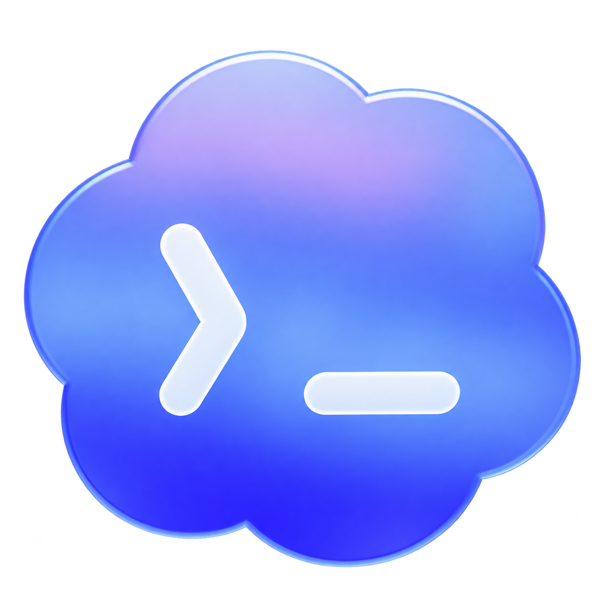

# Codex Cloud Icon for Windows

Give Codex a distinct blue-purple cloud icon so it is easy to distinguish from ChatGPT Classic.



An unofficial, per-user launcher and taskbar helper. It changes the desktop shortcut, Start menu shortcut, and running Codex taskbar button. The cloud has a transparent background and fills the icon area.

## Install

Requires Windows 11 x64, 64-bit Windows PowerShell, .NET Framework 4.x, and the official `OpenAI.Codex` desktop package. The app may appear as **ChatGPT** in Windows. ChatGPT Classic is a separate package.

1. Download the release ZIP and extract it to a folder.
2. Double-click **Install.cmd**, or run `powershell.exe -NoProfile -ExecutionPolicy Bypass -File .\Install.ps1` from that folder.
3. Open **Codex (Cloud Icon)** from the desktop or Start menu.
4. Right-click its running cloud taskbar button and select **Pin to taskbar**. Unpin the old official Codex entry if you want to remove the duplicate.

No administrator access is needed. The installer compiles the included C# source locally using Windows' .NET Framework compiler. It does not download or execute remote scripts. `Install.cmd` uses a process-only execution policy setting; it does not change the computer's saved PowerShell execution policy.

## Remove

Run **Uninstall.cmd** from the extracted project folder. It stops this helper, restores the window properties it saved, and removes the shortcuts and installed files it owns. Codex stays open. Manually unpin a remaining cloud taskbar button. Upgrade backups and unrelated files are retained.

To stop the helper temporarily without uninstalling, run the installed `CodexIconLauncher.exe` with `--restore`.

## Updates

The icon and launcher live in a per-user folder outside the versioned WindowsApps installation directory. The launcher uses Codex's registered application ID, and it identifies running windows by package family rather than a versioned executable path. It reapplies the icon when Codex is opened through **Codex (Cloud Icon)**.

This is expected to survive routine app updates. Opening the official app shortcut by itself does not start the helper. Changes to the app's package identity, Windows taskbar behavior, or security policy can require a project update. No automatic update monitoring, startup service, or scheduled task is installed.

## How it works

- Creates separate shortcuts; it does not modify the official app's installation files.
- Uses a small helper while Codex is open to set its window icons, taskbar grouping identity, and relaunch icon.
- Matches the exact configured Codex package family. ChatGPT Classic is not selected.
- Rechecks visible windows every two seconds and exits about one minute after Codex has no visible top-level windows.
- Restores the saved icons and properties when the helper exits normally. Force-killing the helper can leave the custom icon until Codex closes.
- Makes no network requests, reads no chat data, and stores only local configuration and a status log.

Windows provides the [taskbar relaunch icon property](https://learn.microsoft.com/en-us/windows/win32/properties/props-system-appusermodel-relaunchiconresource) and [process package-family query](https://learn.microsoft.com/en-us/windows/win32/api/appmodel/nf-appmodel-getpackagefamilyname) used here. Changing another application's window properties at runtime is an unofficial customization and can conflict with other taskbar tools.

When an installer is launched inside a packaged app, Windows may redirect AppData writes. The installer resolves the physical on-disk paths before creating shortcuts so Explorer can find their icon and launcher.

## Build and checks

```powershell
.\scripts\Build.ps1
.\tests\Test-Package.ps1
.\scripts\Package.ps1
```

Advanced installation options:

```powershell
.\Install.ps1 -InstallDirectory 'C:\Path\With Spaces\CodexCloudIcon' -NoAttach -NoShortcuts
.\Uninstall.ps1 -InstallDirectory 'C:\Path\With Spaces\CodexCloudIcon'
```

`--attach` changes only already-running Codex windows. `--check` validates configuration, icon loading, and package matching without changing windows. Diagnostics are written to `taskbar-icon-status.txt` in the actual installation folder; the installer prints that folder's path.

Version 0.1.0 was checked on one Windows 11 x64 machine with the `OpenAI.Codex` MSIX package. Other computers, ARM64, Windows 10, and unpackaged installations have not been verified. Helper memory use varies; the earlier local implementation used approximately 30 MB.

## Project and branding

Independent community customization; not affiliated with or endorsed by OpenAI. Codex and ChatGPT names and branding belong to their respective owners. The cloud asset is an unofficial adaptation of the former Codex logo, not an official replacement icon.

The MIT license covers this project's code and scripts. It does not grant rights to OpenAI branding or the files in `assets/`. See [ASSETS.md](ASSETS.md).
